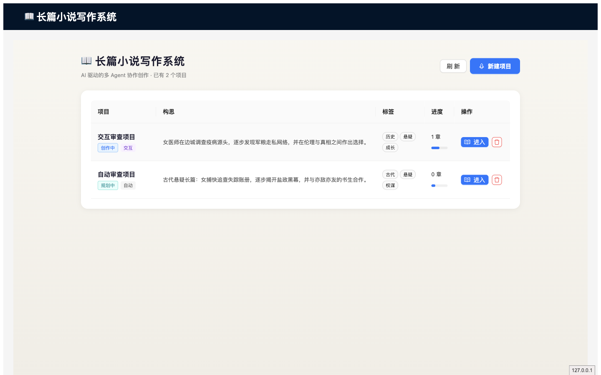
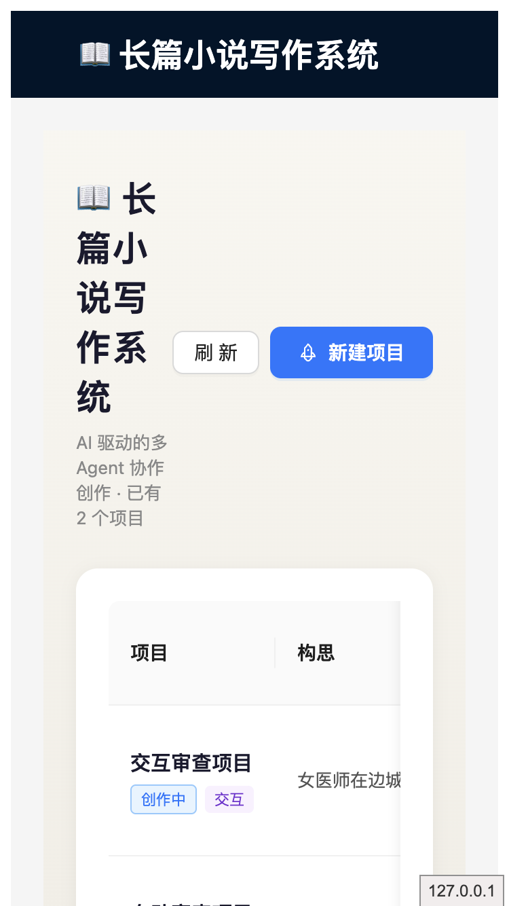
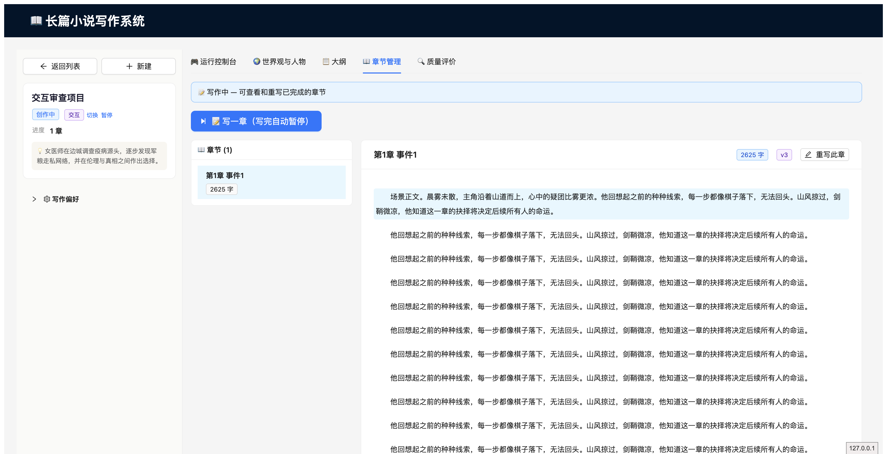
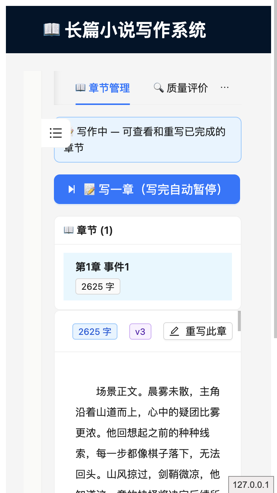

# 页面功能与交互产品一致性审查

> 审查日期：2026-09-02  
> 审查范围：项目列表、项目创建、自动/交互模式、世界观与人物、卷章大纲、章节写作与审核、质量评估、运行进度、桌面与移动端布局  
> 审查方法：以真实页面操作为主，结合接口返回与相关前后端实现交叉确认；使用隔离数据库和 Scenario LLM，未修改业务数据与产品代码。

## 1. 结论摘要

当前产品已经具备小说生产主链路和一部分人工审核能力，但与目标产品定义仍有明显差距，暂不宜将“自动模式”和“审核后改写”作为可信的正式能力对外承诺。

本次共确认 **16 项不一致或交互问题**：

- **P0 阻断问题 3 项**：审核改写指令未执行、独立章节重写无响应、交互切换自动后不继续运行。
- **P1 核心能力缺口 8 项**：自动模式不能端到端推进、错误状态仍允许写章、审核后正文永久加载、人工增改能力不完整、多审核项操作对象错误、审核信息不足等。
- **P2 体验与表达问题 5 项**：进度阶段错误、移动端布局与无障碍问题、文案错误、伪进度、质量结果自相矛盾。

按用户给出的三项目标判断：

| 产品目标 | 审查结果 | 结论 |
| --- | --- | --- |
| Agent 全自动推进，人只负责审查或修改 | 自动项目仍需人工逐段启动；“自动模式”没有持续推进到目标章节或终态 | **不符合** |
| 人机交互由人推动，各环节可由 Agent 辅助 | 暂停与批准基本可用，但部分“改写”不执行，模式切换不续跑 | **部分符合** |
| 世界观、人物、大纲、章节均可人工修改、添加，也可让 Agent 修改 | 世界观/人物只有部分字段可改；大纲、章节缺少人工新增；章节没有直接正文编辑；Agent 修改多为固定动作 | **不符合** |
| 页面信息、按钮与产品状态一致，符合交互预期 | 存在无效按钮、无反馈操作、错误进度、移动端遮挡和文案问题 | **不符合** |

## 2. 设计基线

本次以产品目标和现有系统设计文档为共同基线：

1. **自动模式**：用户创建项目后，Agent 负责世界观、人物、大纲和章节的连续推进；人可以查看、审查、人工修改，或要求 Agent 修改。
2. **交互模式**：由人确认并推动关键阶段；系统在初始设定、卷大纲、章节等检查点暂停，并提供有效的批准、拒绝、带意见改写。
3. **模式可切换**：自动切交互后在下一检查点暂停；交互切自动后跳过等待并继续推进。
4. **内容可管理**：世界观、人物、大纲、章节均应支持人工增加与修改；Agent 辅助不应取代人工操作入口。
5. **界面真实反映状态**：按钮只在有效状态出现或可用，进度和质量结果不能使用容易误导的占位语义。

## 3. 详细问题清单

### P0-01 初始设定/卷大纲的“修改意见重写”没有执行改写

- **实际表现**：在初始设定检查点输入“把世界观改成低魔历史题材，删除所有修炼境界”，点击“重写后批准”后，页面提示“已修改并批准”，项目进入下一阶段；但世界观仍保留“修炼体系、境界”等内容，指令文本也未进入结果。
- **根因证据**：当前检查点处理只对章节检查点执行真正的章节重写；初始设定和卷大纲的修改意见仅被记录为检查点已处理，随后直接推进状态。
- **影响**：用户被明确告知改写成功，实际内容没有变化，属于数据真实性和信任问题。
- **产品期望**：不同检查点必须路由到对应 Agent 重做世界观/人物或卷大纲；只有新结果生成并保存成功后才显示“已修改并批准”。
- **建议验收**：分别对初始设定、卷大纲提交可机器识别的修改指令，确认目标实体版本或内容发生变化，页面展示修改前后摘要，再允许批准。

### P0-02 “重写此章”在没有待审核检查点时完全无响应

- **实际表现**：打开已完成章节，点击“重写此章”，输入“改为女医师视角并增加证据推理”，点击“重写后批准”；弹窗不关闭、无成功或错误提示，章节版本和正文均未变化。
- **根因证据**：独立重写弹窗复用了检查点改写提交函数；当页面不存在当前检查点时函数直接返回。代码中虽有独立章节重写处理函数，但没有连接到按钮。
- **影响**：核心 Agent 修改入口是死操作，用户无法判断是网络慢、操作失败还是功能未实现。
- **产品期望**：独立章节重写与检查点改写使用各自明确的提交路径；提交后显示处理中状态、成功/失败反馈和新版本。
- **建议验收**：对已完成且无待审核项的章节执行重写，断言版本递增、正文变化、弹窗关闭、列表与正文同步刷新。

### P0-03 交互模式切换为自动模式后仍停在审核点

- **实际表现**：章节 2 处于 `PAUSED_AT_CHECKPOINT` 时切换为自动模式，页面提示“已切换到自动模式”，但项目仍保持暂停，待审核项仍为 1，Agent 不继续运行。
- **影响**：直接违反“交互 → 自动时跳过等待并继续”的模式定义；用户会误以为系统已在后台工作。
- **产品期望**：切换成功后明确处理当前检查点，可按产品策略自动批准并继续，或弹出一次性确认；不能只改模式字段。
- **建议验收**：在初始设定、卷大纲、章节三类暂停点分别切换为自动模式，确认暂停解除且状态在合理时间内继续变化。

### P1-01 “自动模式”不能全自动完成主流程

- **实际表现**：创建自动项目后停在 `CONCEIVING`，不会自动启动；点击一次“推进状态”只到 `PLANNING`，仍需继续人工点击。进入写作后还要手工点击“写一章”或“连续写作（最多50章）”。对于 100/200/400 章项目，需要多次人工重新启动。
- **界面承诺**：创建框写着“全自动生成，无需干预”，与实际流程不一致。
- **影响**：产品最核心的模式差异没有落地；自动模式只是减少检查点，而非自动推进。
- **产品期望**：提供明确的“开始自动创作/暂停自动创作”控制，启动后由编排器持续推进到目标章节、人工暂停、预算/错误门禁或最终状态。
- **建议验收**：创建短篇自动项目后只进行一次启动操作，确认能够依次生成设定、大纲和目标章节；刷新和重启后仍能续跑。

### P1-02 无效状态仍开放“写一章”按钮

- **实际表现**：项目尚处于 `CONCEIVING`、没有大纲时，“写一章”按钮可点击，随后才提示“写作失败：无大纲，无法写作”。
- **影响**：页面把必然失败的动作交给用户尝试，增加困惑，也掩盖正确的下一步。
- **产品期望**：按状态禁用或隐藏无效动作，并在主操作区只突出当前可执行的下一步，例如“生成初始设定”。
- **建议验收**：建立状态—操作矩阵，为每种项目状态断言主按钮文案、可用性和辅助说明。

### P1-03 审核批准后章节正文可能永久停留在加载状态

- **实际表现**：章节审核批准并刷新后，章节正文消失，加载动画持续不结束；浏览器实际已连续收到多个章节接口 `200` 响应。页面内刷新无法恢复，只有整页重新加载才重新显示正文。
- **影响**：用户在最常用的“审查—批准—继续阅读”路径中看不到内容，容易重复操作或误判数据丢失。
- **产品期望**：批准后只刷新必要数据，并保证选中章节和正文加载状态正确收敛；接口成功必须结束加载动画。
- **建议验收**：覆盖“章节暂停 → 批准 → 自动刷新 → 正文仍可见”的浏览器回归用例，而不只测试首次打开和懒加载。

### P1-04 世界观和人物只支持部分字段修改

- **实际表现**：
  - 已有世界观条目只能修改正文，不能修改名称和类型。
  - 已有人物只能修改六项描述，不能修改姓名、角色定位等身份字段。
  - 新增世界观时“类型”要求用户手输内部枚举值，缺少选项和说明。
- **影响**：用户不能完整纠错，例如人物更名、角色定位调整、设定分类纠正；内部数据结构直接泄漏给普通用户。
- **产品期望**：所有用户可理解且允许变更的字段都有编辑入口；类型使用中文下拉选项并做校验；不能变更的字段应说明原因。

### P1-05 大纲和章节缺少完整的人工新增/直接编辑能力

- **实际表现**：
  - 大纲可以改已有章节标题和梗概，但没有人工新增卷、增加章节、删除或重排入口。
  - 章节只能要求 Agent 整章重写或编辑段落，没有直接编辑正文并保存的文本编辑器，也没有人工新增章节入口。
  - 段落 Agent 编辑依赖直接点击正文段落，但页面没有可发现的提示。
- **影响**：不满足“世界观、人物、大纲和章节均可人工修改、添加”的明确目标；用户无法把 Agent 初稿当作可控素材继续编辑。
- **产品期望**：为大纲提供新增、删除、拖动/改序及结构校验；为章节提供直接编辑、保存草稿、版本对比/回退和新增章节。

### P1-06 Agent 辅助修改大多是固定动作，无法表达修改意图

- **实际表现**：世界观和人物只有“Agent 增补”类固定动作；大纲只有“重规划未写卷”；缺少针对选中条目输入自然语言意见、预览修改、确认应用的通用交互。
- **影响**：Agent 能“加内容”，但不容易按用户意图纠错或精修，和“可以通过 Agent 进行修改”的目标有差距。
- **产品期望**：在世界观条目、人物、卷、章节和段落层级提供统一的“让 Agent 修改”入口，明确修改对象、指令、影响范围、预览和确认。

### P1-07 多个待审核项时，“拒绝/修改”可能处理错误对象

- **实际表现**：批准按钮按当前卡片的检查点 ID 提交；但拒绝和修改函数始终取页面认定的“当前检查点”。若同时出现多条待审核卡片，点击较早卡片的拒绝/修改会作用于最新一条。
- **影响**：可能误批准、误拒绝其他章节或阶段，属于高风险对象绑定错误。
- **产品期望**：每个卡片的所有操作都显式绑定自身检查点 ID；操作确认框中显示阶段、章节号和摘要。
- **建议验收**：构造至少两个待审核项，分别从每张卡执行批准、拒绝和修改，确认请求 ID 和最终状态对应正确。

### P1-08 初始设定审核信息不足且位置不符合内容心智模型

- **实际表现**：初始设定检查点位于“章节管理”标签内，只显示“初始设定生成完成，待审核”一行，没有世界观、人物、故事原旨的摘要或差异。
- **影响**：用户必须在多个标签间来回核对后再回到章节管理批准；也无法知道本次审核覆盖什么。
- **产品期望**：审核中心可以集中处理，但卡片需要包含审查对象摘要、变更范围和跳转入口；也可在世界观/人物页就地审核。

### P2-01 暂停时运行进度固定显示在“规划中”

- **实际表现**：章节写完并在 `AFTER_CHAPTER` 等待审核时，运行进度仍显示“规划中”为当前步骤、“写作中”为等待。
- **影响**：用户无法判断 Agent 正在规划、写作还是等待自己审核。
- **产品期望**：暂停状态应结合检查点类型映射阶段；章节审核应显示“写作完成 → 等待章节审核”。

### P2-02 移动端布局可用性和无障碍不足

- **实际表现**：
  - 375px 宽度下，列表页内部标题“长篇小说写作系统”被压到约 71px，几乎逐字竖排。
  - 工作区侧栏收起按钮覆盖第一条提示信息。
  - 侧栏收起控件是无 `aria-label`、无 `title`、无键盘焦点的 `span`。
  - 正文段落点击可进入 Agent 编辑，但段落不是键盘可聚焦控件，也无可见提示。
- **影响**：移动端首屏层级混乱，键盘和辅助技术用户无法发现或执行关键操作。
- **产品期望**：移动端将标题和操作分行；收起按钮不遮内容并采用可聚焦 Button；段落操作提供显式按钮或可访问的交互语义。

### P2-03 文案和命名存在明显错误

- **实际表现**：页面出现“人種伏笔”“人收”等乱码/错字；运行结果提示跳转“章节阅读”，实际标签名为“章节管理”。
- **影响**：降低专业度，也让用户难以根据提示找到功能。
- **产品期望**：建立面向用户的术语表并统一标签、提示和按钮文案；构建时增加异常字符或关键文案检查。

### P2-04 项目列表进度条不是真实创作进度

- **实际表现**：进度条按状态写死百分比，例如 `PLANNING=25%`、`WRITING=50%`，与已写章节数和目标章节数无关。
- **影响**：一个已写 1/400 章和 399/400 章的项目都可能显示 50%，造成强烈误导。
- **产品期望**：写作阶段以“已完成章节/目标章节”计算；构思和规划可使用分段里程碑，同时显示文本数字。

### P2-05 质量结果出现“0/10”与“未发现问题”同时展示

- **实际表现**：当质量评估没有返回有效评分或问题列表时，页面显示“总评分 0/10”，同时显示“发现的问题 0 / 未发现问题”。错误路径还使用浏览器原生 `alert`，与全站反馈组件不一致。
- **影响**：用户无法判断是作品极差、评估失败还是没有数据。
- **产品期望**：区分“未评估、评估失败、有效评分为0、评估通过”；缺失数据不应转换为 0 分；错误使用统一通知并提供重试。

## 4. 已验证可用的能力

以下能力在本次检查中表现正常，可作为后续修复的稳定基础：

- 可创建自动模式和交互模式项目。
- 世界观正文可以人工修改，世界观条目可以人工新增，Agent 增补可以落库。
- 人物描述字段可以人工修改，人物可以人工新增，Agent 增补可以落库。
- 已有大纲章节的标题和梗概可以修改，“重规划未写卷”可以执行。
- 交互模式能在初始设定和章节完成后暂停。
- 章节检查点能够展示评分、字数和正文预览，批准操作可推进状态。
- 写章时可输入本章指导意见。
- 段落选择后存在 Agent 辅助编辑面板。
- 既有浏览器回归套件 8/8 通过：列表溢出与基础无障碍、键盘打开项目、工作区响应式、终态禁用、修订态、懒加载、SSE、人工复核恢复。

这些通过项并不抵消本报告中的场景问题；现有自动化主要覆盖“页面能打开和主接口能返回”，尚未覆盖改写是否真正生效、模式切换是否继续运行，以及审核后的状态同步。

## 5. 建议修复顺序

### 第一批：恢复操作真实性

1. 修复三项 P0：检查点改写真实路由、独立章节重写接线、交互切自动立即续跑。
2. 修复多检查点对象绑定，所有操作显式携带检查点 ID。
3. 为每个异步动作统一增加处理中、成功、失败和可重试状态。

### 第二批：补齐产品核心闭环

1. 将自动模式改成一次启动后持续运行，并提供暂停、恢复、失败原因和预算门禁。
2. 建立状态—操作矩阵，清理必然失败的按钮。
3. 补齐世界观/人物全字段编辑、大纲结构增删改序、章节正文直接编辑与版本能力。
4. 为各层级建立统一“让 Agent 修改”交互：选择对象 → 输入意见 → 预览差异 → 确认应用。

### 第三批：提升信息可信度和移动体验

1. 修正进度计算、检查点阶段映射和质量空状态。
2. 重做移动端标题/按钮布局，避免侧栏控件遮挡。
3. 修正文案并补齐键盘、焦点和可访问名称。

## 6. 建议新增的端到端验收场景

1. **自动项目零干预**：创建 3 章项目 → 一次启动 → 自动生成设定、大纲、3 章正文 → 到达目标终态。
2. **初始设定带意见重做**：提交明确排除词 → 新版本不再含排除词 → 展示差异 → 批准。
3. **卷大纲带意见重做**：改变指定章节事件 → 大纲版本和内容更新 → 已写章节不被覆盖。
4. **独立章节重写**：无待审核项时重写 → 版本递增 → 正文变化 → 可比较并回退。
5. **交互切自动**：在三种检查点切换 → 当前等待被正确处理 → 后续自动运行。
6. **审核后阅读稳定性**：批准章节 → 刷新 → 正文持续可见，无永久加载。
7. **多人工作对象安全**：同时存在两个检查点 → 每张卡的批准/拒绝/修改均命中自身 ID。
8. **人工内容管理**：新增并编辑世界观、人物、卷、章节和正文 → 刷新后数据保持一致。
9. **移动端关键路径**：375px 下创建项目、切标签、审核、编辑段落；无覆盖，所有控件可键盘操作。

## 7. 页面证据

### 项目列表（桌面）

全局顶栏和页面正文重复展示产品标题；列表进度为状态占位比例，而非真实章节完成度。

### 项目列表（移动端）

正文标题被操作区挤压后逐字换行，首屏信息层级明显失衡。

### 章节管理（桌面）

段落被选中后可显示 Agent 编辑区域，但正文中没有明显的可编辑提示，也没有人工直接编辑正文入口。

### 章节管理（移动端）

侧栏收起控件覆盖提示卡片；标签被压缩到省略菜单，当前页面的内容结构和下一步不够清晰。

## 8. 审查边界

- 本次重点是产品功能、状态语义和交互一致性，不评价 Scenario LLM 生成文本本身的文学质量。
- 使用 Scenario LLM 不影响本报告中的按钮接线、状态迁移、版本变化、人工编辑入口和响应式布局证据。
- 未执行破坏性数据操作，未修改产品实现；审查项目和数据位于隔离测试目录。
